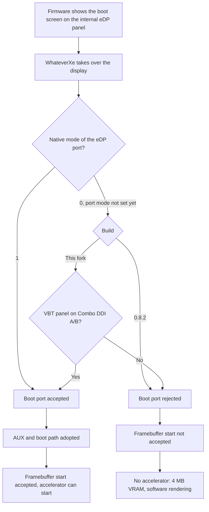

# WhateverXe-eDP-BootFix

Personal fork of [b00t0x/WhateverXe](https://github.com/b00t0x/WhateverXe) 0.8.2 with one fix, written with Claude Code. [日本語](README_ja.md)

- **Fix:** the internal eDP boot port is now accepted at the firmware handoff, so laptops with a built-in eDP panel (e.g. Alder Lake-N / Twin Lake) are no longer left without graphics acceleration.
- **Status:** CPU tests and the build pass; not yet verified on real hardware.
- **Usage:** build with `python3 tools/build.py`. Requirements and setup are the same as [upstream](https://github.com/b00t0x/WhateverXe#readme).
- **Credits:** fix based on [Thatisjigen/WhateverXe `9c219ee`](https://github.com/Thatisjigen/WhateverXe/commit/9c219ee0cb56a737ecf0f3d2b1130bdc4161e8c9). WhateverXe retains WhateverGreen's copyright notices and BSD-3-Clause license ([LICENSE.txt](LICENSE.txt)); all other credits are listed in the [upstream README](https://github.com/b00t0x/WhateverXe#license-and-credits).

## The problem this fork addresses

On a laptop with an Intel N150 (Twin Lake, iGPU `8086:46D4`) and only a built-in eDP panel, WhateverXe 0.8.2 on macOS Tahoe loads and every readiness check passes, yet there is no acceleration: 4 MB VRAM, "No Kext Loaded", and `N97FramebufferStartAccepted = No`.

The cause is timing. When WhateverXe takes the display over from the firmware, Apple's driver has not yet set the port mode, so the eDP port still reports mode 0. WhateverXe 0.8.2 accepted only mode 1, rejected the boot port, and the framebuffer and accelerator start failed as a result.

Mode 0 is accepted only at this handoff and only for the panel port named by the firmware's VBT; every other check is unchanged. The path through "This fork" is the intended behavior and has not yet been confirmed on hardware.
