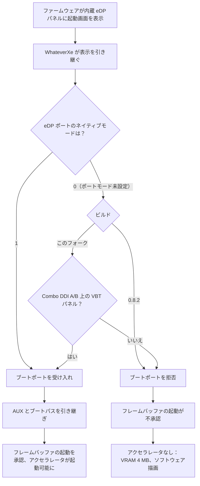

# WhateverXe-eDP-BootFix

[b00t0x/WhateverXe](https://github.com/b00t0x/WhateverXe) 0.8.2 に修正を 1 つ加えた自分用フォークです。修正は Claude Code によるものです。[English](README.md)

- **修正内容:** ファームウェアからの引き継ぎ時に内蔵 eDP のブートポートを受け入れるようにしました。内蔵 eDP パネルのノート PC（Alder Lake-N / Twin Lake など）でグラフィックスアクセラレーションが有効にならない問題への対処です。
- **状態:** CPU テストとビルドは成功しています。実機での動作確認はまだ行っていません。
- **使い方:** `python3 tools/build.py` でビルドします。必要なものと設定は[本家](https://github.com/b00t0x/WhateverXe/blob/main/README_ja.md)と同じです。
- **クレジット:** 修正は [Thatisjigen/WhateverXe `9c219ee`](https://github.com/Thatisjigen/WhateverXe/commit/9c219ee0cb56a737ecf0f3d2b1130bdc4161e8c9) を基にしています。WhateverXe は WhateverGreen の著作権表示と BSD-3-Clause ライセンスを引き継いでいます（[LICENSE.txt](LICENSE.txt)）。その他のクレジットは[本家 README](https://github.com/b00t0x/WhateverXe/blob/main/README_ja.md) に記載されています。

## このフォークが対処する問題

Intel N150（Twin Lake、iGPU `8086:46D4`）搭載で内蔵 eDP パネルのみのノート PC では、macOS Tahoe 上の WhateverXe 0.8.2 が読み込まれ、準備状態のチェックもすべて通るのに、アクセラレーションが有効になりません。VRAM は 4 MB、「No Kext Loaded」と表示され、`N97FramebufferStartAccepted = No` になります。

原因はタイミングです。WhateverXe がファームウェアから表示を引き継ぐ時点では、Apple のドライバがまだポートモードを設定していないため、eDP ポートのモードは 0 のままです。WhateverXe 0.8.2 はモード 1 しか受け入れないのでブートポートを拒否し、その結果フレームバッファとアクセラレータの起動が失敗していました。

モード 0 を受け入れるのはこの引き継ぎ時だけで、対象はファームウェアの VBT がパネルとして示すポートに限られます。それ以外のチェックは変えていません。「このフォーク」の経路は意図した動作であり、実機ではまだ確認していません。
